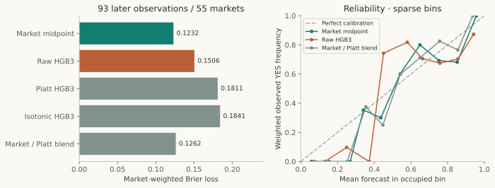

# PolyBTC Research

**Can machine learning provide a statistically reliable and economically exploitable edge in Polymarket's five-minute Bitcoin markets?**

PolyBTC investigates that question through causal data engineering, matched forecast comparisons, calibration, execution diagnostics and cost-aware simulation. It includes a functioning Python research engine and a publication-first website.

**Finding:** the tested methods have not demonstrated incremental forecast value over market probabilities or a credible after-cost advantage. In the later paired cohort, market Brier loss was **0.123156** versus **0.150580** for frozen HGB3 on **93 observations / 55 markets**. The raw-minus-market Brier interval includes zero. This is a small, exploratory chronological result, not proof that every ML approach fails. [Methods and uncertainty](research/papers/forecast-calibration.md).

[Open the research website](https://polybtc-research.vercel.app/) · [Read the research collection](research/README.md) · [Reproduce results](docs/REPRODUCTION.md) · [System and deployment](docs/DEPLOYMENT.md)


## Research papers

| Paper | Focus |
|---|---|
| [From Market Snapshots to Causal Research Data](research/papers/market-data-provenance.md) | Identity, timestamps, labels, overlap and feature eligibility |
| [Machine Learning versus Market-Implied Bitcoin Probabilities](research/papers/models-versus-market.md) | Matched baselines, nonlinear models and market-relative features |
| [Probability Calibration under Limited Independent Data](research/papers/forecast-calibration.md) | Proper scores, reliability and paired uncertainty |
| [Execution Timing and Data Freshness in Five-Minute Markets](research/papers/execution-timing.md) | Eligibility losses and the limits of latency counterfactuals |
| [Expected Value, Costs and the Limits of Paper Trading](research/papers/strategy-economics.md) | Payout estimates, constraints and hypothetical policy results |



*The same 93 later observations for all forecasts, with equal total weight per market. Reliability bins are sparse; lower Brier/log loss is better. Full counts and source hashes accompany the paper.*

## Explore the website

Read the canonical papers, filter frozen predictions by partition, horizon or market, compare scores on identical observations, and inspect individual forecasts. Calibration rows remain labelled fitting data. The static demo makes no market requests and has no trading controls.

```powershell
Set-Location dashboard/frontend
npm ci
npm run build
npm run preview
```

Open [PolyBTC Research locally](http://127.0.0.1:3000/#/). A fresh checkout can build from included papers, figures and curated sources. Regenerating evidence requires the documented local research artifacts.

## Engineering proof of concept

The engine implements market acquisition, source verification, causal features, frozen inference, chronological evaluation, paper simulation, risk checks, durable decisions and settlement/reconciliation. Its read-only local monitor preserves prediction, decision, performance, resolution and health views. Successful integration and simulated fills establish software behavior, not profitability.

Use `npm run dev` for the site with access to the local monitor. See [dashboard setup](dashboard/README.md), [paper operation](docs/PAPER_TRADING.md) and [operations](docs/OPERATIONS.md). Live trading remains disabled. Building the site does not start or reconfigure collectors or trading processes.

## Repository guide

| Location | Responsibility |
|---|---|
| [research/](research/README.md) | Canonical papers, figures, source extracts and claim/reproduction manifests |
| [datasets/](datasets/README.md) | Schemas, hashes, availability and provenance |
| [experiments/](experiments/README.md) | Index to retained historical experiments |
| [scripts/](scripts/README.md) | Research, modeling and operations, organized into purpose-specific subdirectories |
| `src/polybtc/` | Stable Python data, model, strategy, risk and execution packages |
| [dashboard/](dashboard/README.md) | Research frontend and read-only local backend |
| [tests/](tests/README.md) | Data, modeling, strategy, execution and runtime checks |
| `data/` | Preserved local raw data, models, historical outputs and operational stores |
| [docs/](docs/ARCHIVE.md), `ToOrganize/`, `research-OoD/` | Technical documentation and historical reports/notebooks |

## Reproduce important results

The publication builder recalculates saved forecast scoring and hypothetical-trade accounting, then creates figures and safe public extracts. It does not retrain the deployed model, fetch outcomes or replay operational decisions.

```powershell
.\.venv-execution\Scripts\python.exe -m pip install --target .publication-deps -r requirements-publications.lock
.\.venv-execution\Scripts\python.exe -B scripts/research/build_publications.py
.\.venv-execution\Scripts\python.exe -B scripts/research/verify_publications.py
```

See [reproduction levels and prerequisites](docs/REPRODUCTION.md). The additional cumulative export is normalized separately with row identity, flags and a versioned manifest. Its raw input is unchanged. It overlaps training and prior research and lacks retained October 14–17 labels; it is not an independent test.

The grouped-script migration was checked with the core suite: **522 passed, 1 skipped**, with one CLI-path failure subsequently fixed. The affected-module rerun then passed **83 tests**, including that case. Frontend build, lint and publication validation also pass; see [publication readiness](docs/PUBLICATION_READINESS.md) for the exact verification scope. Historical validation is recorded in the [transformation report](docs/TRANSFORMATION_REPORT.md). Missing original artifacts, limited independent markets, provider/clock qualifications and unknown historical fill mechanics remain explicit limitations.

## License

Original project code and authored documentation, papers and figures are available under the [MIT License](LICENSE), unless a file states otherwise. Third-party dependencies, source data and third-party material retain their respective terms; this license does not grant rights to upstream market data. See [dataset availability and redistribution notes](datasets/README.md).
