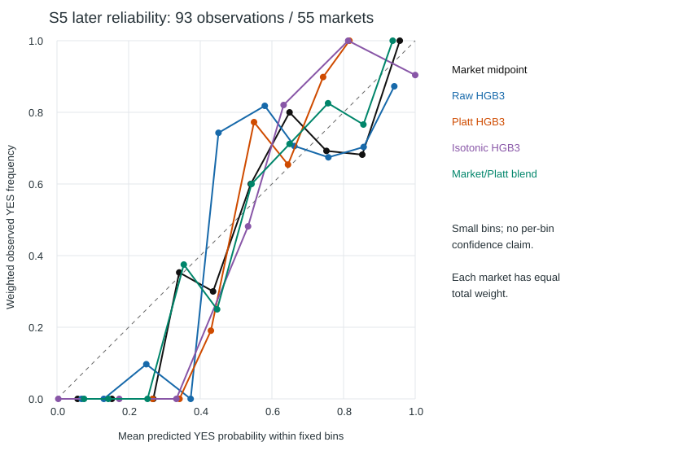

# S5: Probability calibration and incremental forecast value

Date: 2026-10-14. **Outcome C, provisional:** the retained market benchmark is better on point estimates; no credible incremental improvement by frozen HGB3 or its fitted combinations is demonstrated. Brier uncertainty for raw HGB3 includes equality, so this is not a universal inferiority claim. A larger genuinely prospective final test remains necessary.

## Separation and eligibility

The main artifact SHA-256 is `42647c6810f8ee01313aee24362e0c83e20b4240f951316d2d576160327752e4`. Its manifest and training CSV hash agree. It was created 2026-10-12 08:45:19 UTC and refitted on **33,366 rows / 5,588 markets**, prediction times 2026-09-17 17:26 through 2026-10-11 15:04:30. No operational candidate market overlaps those training IDs. Current stored probabilities reproduce from the unchanged artifact on **705 selected decisions**; 159 additionally satisfy causal reference/anchor provenance, fresh paired prediction books and official-source registry labels.

| Partition | Rows | Markets | First prediction UTC | Last prediction UTC | YES markets |
|---|---|---|---|---|---|
| calibration | 66 | 42 | 2026-10-12T14:47:00.000000+00:00 | 2026-10-13T10:56:00.000000+00:00 | 23 |
| evaluation | 93 | 55 | 2026-10-13T14:33:00.000000+00:00 | 2026-10-13T21:13:00.000000+00:00 | 25 |

Split boundary is **2026-10-13 14:30 UTC**, the session boundary used in the funnel investigation. Market IDs do not cross partitions; all earlier labels' recorded resolution times precede this boundary. Calibration and combination fitting use only the earlier partition. Later prices were already inspected for infrastructure diagnostics, but their labels did not fit these calibrators. This is an exploratory chronological holdout for a frozen model, **not a prospectively preregistered strategy-selection test**. The S5 readout and sensitivities now consume it for research; do not retune and call it untouched again. Full raw resolution/retrieval evidence is absent from the registry, so label-availability/finality claims remain conditional as explained in the economics audit.

Forecast comparisons use market midpoint from the **same selected prediction snapshot**, available by the cutoff, rather than a later execution quote. Both books must have source ages 0–500 ms at cutoff, reference 0–3,000 ms, causal anchor and bound retained evidence. Operational inference can run when books fail this stricter paired-benchmark test; those rows are not pooled here. No outcomes were proxied from spot BTC. Missingness is selective and late horizons are especially underrepresented.

## Methods fixed before calibration fitting

Raw HGB3 is the identity-calibrated artifact. Platt calibration is logistic regression on logit(raw p), C=1, L2 regularization, lbfgs, with one total unit of weight per calibration market. Its fitted slope is **0.382336** and intercept **0.060187**. Isotonic regression is increasing, clips outside its training range and uses the same weights. With only 42 calibration markets, isotonic is exploratory and can create unjustified endpoint certainty.

Strategy C's forecasting probability is `(1-alpha)*market + alpha*Platt(raw)`, with alpha constrained to [0,1] and minimizing weighted Brier **on calibration only**. Fitted alpha is **0.136095** (13.61% model, 86.39% market). This two-stage fit is itself in-sample on a small calibration set; its performance must be judged only later. The equal raw/market blend and constant 0.5 are untuned controls. No method was attached to the deployed artifact; parameters are in `data/research/s5_v1/calibration_s5_exploratory_v1.json` and are marked exploratory.

Metrics give **each market equal total weight**; its available horizons share that weight. Accuracy uses p>=0.5 as YES. Natural-log loss clips probabilities to [1e-15,1-1e-15] only for numerical scoring; this does not change forecasts or execution. ECE uses ten fixed equal-width [0,.1), ... bins, last bin includes 1; it is the market-weighted absolute difference between bin mean forecast and outcome rate. Empty bins are omitted. ECE is bin-dependent and is not a proper scoring rule or proof of tradability.

## Later paired forecast metrics

| Forecast | Rows / markets | Brier | Log loss | Accuracy | ECE |
|---|---|---|---|---|---|
| Market midpoint | 93 / 55 | 0.123156 | 0.385148 | 0.836364 | 0.095407 |
| Raw HGB3 | 93 / 55 | 0.150580 | 0.465150 | 0.772727 | 0.136479 |
| Platt HGB3 | 93 / 55 | 0.181082 | 0.548944 | 0.818182 | 0.189739 |
| Isotonic HGB3 | 93 / 55 | 0.184132 | 0.860512 | 0.656061 | 0.078945 |
| Market/Platt blend | 93 / 55 | 0.126235 | 0.401337 | 0.836364 | 0.096927 |
| Equal market/raw blend | 93 / 55 | 0.130312 | 0.408919 | 0.806061 | 0.083171 |
| Constant 0.5 | 93 / 55 | 0.250000 | 0.693147 | 0.454545 | 0.045455 |

Lower Brier/log loss is better. Platt's compression toward 0.5 hurts later discrimination/confidence. Isotonic has lower binned ECE than raw but much worse log loss, including incorrect endpoint forecasts; do not select it by ECE alone. The blend closely tracks market but does not improve it. Raw HGB3 beats the uninformed 0.5 control, which shows some outcome information, but **information beyond market is the relevant question**.

## Uncertainty and dependence

Paired differences are computed within each market over its matched horizons. Intervals use 2,000 resamples of whole markets (seed 20261014), preserving all horizon dependence. A circular moving-block sensitivity resamples six successive eligible markets ordered by target time. Those blocks are not necessarily contiguous 30-minute periods because acquisition coverage has gaps. Neither interval captures all longer regime dependence or calibration-fitting uncertainty; these are conditional intervals for the fitted models, not simultaneous multiple-comparison guarantees.

| Forecast minus market | Brier delta | 95% market-cluster CI | 95% six-market block CI | Log-loss delta / cluster CI |
|---|---|---|---|---|
| Raw HGB3 | 0.027424 | [-0.006809, 0.064703] | [-0.012964, 0.068115] | 0.080001 / [0.003391, 0.161934] |
| Platt HGB3 | 0.057926 | [0.032178, 0.083087] | [0.032145, 0.084154] | 0.163795 / [0.104491, 0.219907] |
| Isotonic HGB3 | 0.060976 | [0.031795, 0.088743] | [0.028290, 0.095984] | 0.475363 / [0.104970, 1.006147] |
| Market/Platt blend | 0.003079 | [-0.000188, 0.006141] | [0.000063, 0.006155] | 0.016189 / [0.007535, 0.023946] |
| Equal market/raw blend | 0.007155 | [-0.008689, 0.024254] | [-0.011193, 0.025421] | 0.023771 / [-0.010530, 0.058715] |

Positive deltas favor market. Raw Brier's interval crosses zero; its log-loss cluster interval favors market, but 55 markets over part of one day cannot establish broad superiority. No choice of method/horizon is promoted from a favorable slice. For planning only, observed paired-market Brier SD 0.1355 implies roughly **1441 independent evaluation markets** to detect a 0.01 Brier difference at nominal 5% two-sided significance/80% power using a normal approximation. Serial dependence, calibration estimation and selection require inflation; the audit's 2,000-evaluation-market floor must be revised if the resulting confidence interval remains too wide.

## Horizon and probability-band diagnostics

| Horizon | Rows / markets | Market Brier | Raw Brier | Platt Brier | Blend Brier |
|---|---|---|---|---|---|
| 240 | 19 / 19 | 0.107839 | 0.084365 | 0.162378 | 0.111770 |
| 180 | 25 / 25 | 0.137803 | 0.156139 | 0.186638 | 0.139958 |
| 120 | 18 / 18 | 0.204815 | 0.216678 | 0.215177 | 0.202184 |
| 90 | 13 / 13 | 0.116013 | 0.173828 | 0.186081 | 0.120460 |
| 60 | 16 / 16 | 0.118702 | 0.194323 | 0.183902 | 0.120934 |
| 30 | 2 / 2 | 0.067225 | 0.416954 | 0.300549 | 0.087830 |

Raw HGB3 is better on the 240-second point estimate (19 observations), but worse on the other observed horizons. Two 30-second observations cannot support a policy conclusion. Full per-horizon accuracy/log loss/ECE for every forecast and every nonempty probability bin are in the JSON. These are diagnostic slices, not additional threshold-selection datasets.

The plot uses bin mean predicted probability versus weighted observed YES frequency; diagonal means calibrated. Line segments merely connect occupied bins, not fitted probability functions. Small and empty bins make visual ranking unreliable.

### Market midpoint probability bands

| Band | Rows / markets | Mean forecast | YES frequency | Within-bin Brier | Within-bin log loss |
|---|---|---|---|---|---|
| 0.0–0.1 | 14 / 14 | 0.057476 | 0.000000 | 0.004030 | 0.059605 |
| 0.1–0.2 | 9 / 7 | 0.153197 | 0.000000 | 0.024500 | 0.167008 |
| 0.2–0.3 | 5 / 5 | 0.268942 | 0.000000 | 0.072925 | 0.313794 |
| 0.3–0.4 | 7 / 7 | 0.341189 | 0.352941 | 0.222947 | 0.637206 |
| 0.4–0.5 | 6 / 6 | 0.435750 | 0.300000 | 0.225797 | 0.644517 |
| 0.5–0.6 | 7 / 6 | 0.541000 | 0.600000 | 0.240205 | 0.673400 |
| 0.6–0.7 | 11 / 11 | 0.649220 | 0.800000 | 0.184585 | 0.558636 |
| 0.7–0.8 | 11 / 10 | 0.752266 | 0.692308 | 0.200284 | 0.583313 |
| 0.8–0.9 | 10 / 8 | 0.852270 | 0.681818 | 0.243110 | 0.706444 |
| 0.9–1.0 | 13 / 10 | 0.957002 | 1.000000 | 0.002705 | 0.044424 |

### Raw HGB3 probability bands

| Band | Rows / markets | Mean forecast | YES frequency | Within-bin Brier | Within-bin log loss |
|---|---|---|---|---|---|
| 0.0–0.1 | 8 / 8 | 0.068593 | 0.000000 | 0.005127 | 0.071300 |
| 0.1–0.2 | 8 / 8 | 0.130686 | 0.000000 | 0.017549 | 0.140364 |
| 0.2–0.3 | 15 / 12 | 0.249337 | 0.096774 | 0.111441 | 0.394805 |
| 0.3–0.4 | 3 / 3 | 0.373181 | 0.000000 | 0.140009 | 0.468032 |
| 0.4–0.5 | 7 / 7 | 0.450854 | 0.742857 | 0.268304 | 0.729914 |
| 0.5–0.6 | 3 / 3 | 0.580104 | 0.818182 | 0.208221 | 0.608670 |
| 0.6–0.7 | 8 / 7 | 0.662773 | 0.705882 | 0.201704 | 0.593195 |
| 0.7–0.8 | 17 / 15 | 0.757607 | 0.674419 | 0.227762 | 0.652862 |
| 0.8–0.9 | 14 / 14 | 0.856117 | 0.703297 | 0.215830 | 0.622714 |
| 0.9–1.0 | 10 / 9 | 0.941629 | 0.872727 | 0.111670 | 0.378253 |

### Platt HGB3 probability bands

| Band | Rows / markets | Mean forecast | YES frequency | Within-bin Brier | Within-bin log loss |
|---|---|---|---|---|---|
| 0.2–0.3 | 6 / 6 | 0.266889 | 0.000000 | 0.071867 | 0.311046 |
| 0.3–0.4 | 12 / 11 | 0.342008 | 0.000000 | 0.117858 | 0.419609 |
| 0.4–0.5 | 19 / 17 | 0.429718 | 0.190476 | 0.203935 | 0.600136 |
| 0.5–0.6 | 15 / 14 | 0.550028 | 0.772727 | 0.229185 | 0.651211 |
| 0.6–0.7 | 29 / 20 | 0.644885 | 0.654088 | 0.224232 | 0.640125 |
| 0.7–0.8 | 11 / 11 | 0.742951 | 0.898551 | 0.114674 | 0.401134 |
| 0.8–0.9 | 1 / 1 | 0.816401 | 1.000000 | 0.033709 | 0.202850 |

### Isotonic HGB3 probability bands

| Band | Rows / markets | Mean forecast | YES frequency | Within-bin Brier | Within-bin log loss |
|---|---|---|---|---|---|
| 0.0–0.1 | 9 / 9 | 0.003650 | 0.000000 | 0.000081 | 0.003691 |
| 0.1–0.2 | 3 / 3 | 0.173817 | 0.000000 | 0.030673 | 0.191274 |
| 0.3–0.4 | 4 / 4 | 0.333226 | 0.000000 | 0.111039 | 0.405304 |
| 0.5–0.6 | 58 / 42 | 0.533411 | 0.481752 | 0.250242 | 0.693616 |
| 0.6–0.7 | 6 / 6 | 0.632653 | 0.820513 | 0.182563 | 0.555405 |
| 0.8–0.9 | 1 / 1 | 0.812887 | 1.000000 | 0.035011 | 0.207163 |
| 0.9–1.0 | 12 / 11 | 1.000000 | 0.904110 | 0.095890 | 3.312014 |

### Market/Platt blend probability bands

| Band | Rows / markets | Mean forecast | YES frequency | Within-bin Brier | Within-bin log loss |
|---|---|---|---|---|---|
| 0.0–0.1 | 9 / 9 | 0.075574 | 0.000000 | 0.005775 | 0.078620 |
| 0.1–0.2 | 12 / 9 | 0.143223 | 0.000000 | 0.021013 | 0.154922 |
| 0.2–0.3 | 6 / 6 | 0.252682 | 0.000000 | 0.065509 | 0.292760 |
| 0.3–0.4 | 6 / 6 | 0.354049 | 0.375000 | 0.224901 | 0.640695 |
| 0.4–0.5 | 8 / 8 | 0.447036 | 0.250000 | 0.219441 | 0.631606 |
| 0.5–0.6 | 7 / 6 | 0.543130 | 0.600000 | 0.237156 | 0.667297 |
| 0.6–0.7 | 14 / 14 | 0.649279 | 0.711864 | 0.216073 | 0.624801 |
| 0.7–0.8 | 11 / 11 | 0.756717 | 0.825397 | 0.145745 | 0.468917 |
| 0.8–0.9 | 9 / 8 | 0.855408 | 0.765957 | 0.177842 | 0.535912 |
| 0.9–1.0 | 11 / 9 | 0.937189 | 1.000000 | 0.004418 | 0.065142 |

### ECE bin sensitivity

| Bins | Market midpoint | Raw HGB3 | Platt HGB3 | Isotonic HGB3 | Market/Platt blend |
|---|---|---|---|---|---|
| 5 | 0.060717 | 0.127596 | 0.100660 | 0.076677 | 0.073230 |
| 10 | 0.095407 | 0.136479 | 0.189739 | 0.078945 | 0.096927 |
| 20 | 0.127702 | 0.150037 | 0.205394 | 0.080818 | 0.135874 |

### Distribution drift and return regimes

Earlier-versus-later scores are retained in JSON. Earlier calibration has 23 YES markets out of 42, later evaluation 25 out of 55; horizon availability also differs. These small samples cannot establish a stable recalibration function. The regime diagnostic uses the earlier median absolute 30-second TWAP return, not an outcome-selected threshold or realized spot volatility.

| TWAP-return regime | Rows | Market Brier | Raw Brier |
|---|---|---|---|
| lower | 33 | 0.186827 | 0.231800 |
| higher | 60 | 0.104654 | 0.133682 |

Both return-regime point estimates favor market. Absolute smoothed TWAP return is only a volatility proxy; no reliable independent high/low realized-volatility execution study is available in this prospective cohort. It must not be presented as one.

## Historical predecessor calibration: context only

Chronological market-grouped training/calibration/evaluation counts were 3,352/1,118/1,118 markets. Their periods were September 17–October 3, October 3–7, October 7–11 respectively. Only 5,054 of 6,662 test rows (1,117 of 1,118 markets) have a paired market forecast. The following recomputation gives each market equal weight, so it differs from older row-weighted report totals.

| Predecessor test forecast | Brier | Log loss | Accuracy | ECE |
|---|---|---|---|---|
| Market midpoint | 0.125697 | 0.391693 | 0.818278 | 0.013921 |
| Raw HGB3 | 0.156838 | 0.482972 | 0.779722 | 0.026222 |
| Platt HGB3 | 0.156424 | 0.481706 | 0.780051 | 0.020874 |
| Isotonic HGB3 | 0.157903 | 0.501244 | 0.778842 | 0.036018 |

Market is better on this paired predecessor cohort too. Calibration moves scores slightly without closing the gap. These saved predictions came from a different, earlier-partition fitted model; all evaluation markets then entered the final artifact's training. They are **not** independent performance of the frozen artifact, and repeated historical model-selection work further limits inference. Do not deploy its stored calibrators onto the full refit.

## Conclusion

No calibration or combination is justified for operational promotion. Preserve raw HGB3 and current operation pending review; research model/feature additions against the strong market benchmark rather than fitting trading thresholds to these outcomes. The economics audit specifies the next genuinely prospective dataset and acceptance gates. No forecast probability is asserted to be objective truth.

Reproduce with the commands in [the audit](POLYBTC_S5_STRATEGY_ECONOMICS_AUDIT.md). [Machine evidence](POLYBTC_S5_EVIDENCE.json) contains complete metrics, conditional intervals, bin points, parameters, hashes, exclusions and row membership.

## Other existing benchmarks (archival context)

These are existing saved research predictions, not newly trained or independently evaluated candidates. They overlap historical development periods; comparisons across panels or against the prospective 55-market sample are invalid. No current-v2 deployment decision is based on them.

`data/experiments/model_expansion/vm_expansion_v2/hgb3_xgb_v2_comparison.csv` — 2026-10-07 17:56:00+00:00 to 2026-10-11 15:04:30+00:00

| Forecast | Rows / markets | Brier | Log loss |
|---|---|---|---|
| normalized_yes_mid | 5054 / 1117 | 0.125697 | 0.391693 |
| xgb_raw | 5054 / 1117 | 0.156949 | 0.483074 |
| xgb_platt | 5054 / 1117 | 0.156496 | 0.481676 |
| xgb_isotonic | 5054 / 1117 | 0.158364 | 0.491589 |

`data/normalized/p115_market_anchored_walk_forward_predictions.csv` — 2026-09-24T18:56:00+00:00 to 2026-10-01T17:09:00+00:00

| Forecast | Rows / markets | Brier | Log loss |
|---|---|---|---|
| raw_market_probability | 8914 / 1994 | 0.124642 | 0.389385 |
| market_only_probability | 8914 / 1994 | 0.124792 | 0.389800 |
| market_plus_btc_probability | 8914 / 1994 | 0.124980 | 0.390215 |
| btc_only_walk_forward_probability | 8914 / 1994 | 0.159392 | 0.503675 |

