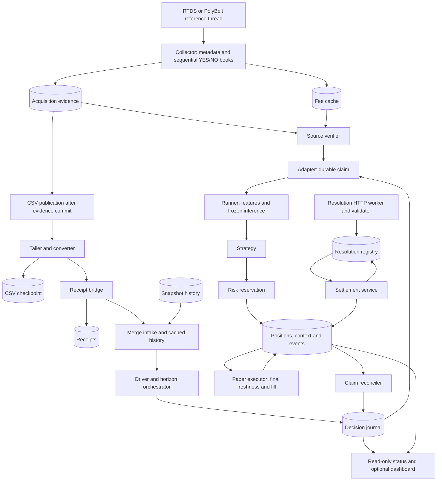

# PolyBTC v2 — S1 Architecture Simplification Audit

Date: 2026-10-13. Status: proposal for review. **No production refactor is authorized or performed in S1.**

The recommended target is **two operational processes, two authoritative SQLite stores, one paper evaluation coordinator, and pure verification/model/strategy/risk functions**. Keep network acquisition isolated from evaluation. Make CSV a research export rather than live transport, after a separately validated migration. Start much smaller: establish a shared clock-safety boundary with durable incident capture and a recoverable evaluation pause.

Simplification should remove duplicated representations, owners and transactions—not checks protecting different deadlines. Architecture cannot create absent books or make an old upstream observation fresh.

## 1. Scope and evidence

Read: `docs/PAPER_TRADING.md`, `docs/PAPER_EVALUATION_REGRESSION_REPORT.md`, `docs/PAPER_PIPELINE_RECOVERY_REPORT.md`, the development-stage roadmap, supplied `POLYBTC_V2_HARNESS.md` and `POLYBTC_V2_DEVELOPMENT.md`, and the implementations below. The current request supersedes earlier infrastructure priorities.

Read-only operational inspection:

- Latest status: **stopped**, 2026-10-13 10:59:42.603083 UTC; last cycle 10:59:42.330055, recorded PID 11892. This does not identify the exception time or establish current process existence.
- Recorded configuration: paper enabled, live disabled, reference 3,000 ms, books 500 ms, polling 0.05 s, finalization grace 2 s, execution wait 1 s. Acquisition CLI settings were not independently captured; documented pause is 0.1 s, collector default 1 s.
- 540 decisions, maximum ID 338027; latest target 10:59:30, latest claim dispatch 10:59:32.221600. 32,354 receipts; zero position entries.
- Original CSV and checkpoint both 50,259,204 bytes. State has advanced since the regression report; its counts are historical.
- No operational `.log` files found under `data/live` or `data/paper`. The failing UTC samples, jump magnitude, paired monotonic readings and Windows time-service event are unavailable. An OS adjustment causing this incident is plausible, **not proven**.

Previous measured findings inform this audit: inconsistent 2,000/3,000 ms configuration; 29 absent acquisition windows rather than overlooked candidates; median YES age 437 ms at verification; five subsequent legitimate stale-book rejections. These are dated findings, not a new live reliability assessment.

No network probes, clock changes, bot startups, production edits or trading-state writes were performed. This document is the only S1 deliverable. Existing test results are background; no new implementation/test success is claimed.

## 2. Current component and dependency map



This is responsibility flow, not one transaction. Source verification precedes adapter claim; HGB3 currently runs before the runner rejects false provenance flags. Execution freshness is checked again after claim/inference and at simulated execution.

| Component / actual implementation | Classification | Keep / merge / remove decision |
|---|---|---|
| `collect_vnext_local.py`: `ReferenceFeed`, `PolyBoltFeed`, `MarketCollector.collect` | Essential | Keep settlement-relevant reference, opening strike, metadata/token binding and both books. Feed implementations are alternatives. |
| Collector warmup, auxiliary history, book completeness/crossing, interval and timestamp checks | Essential validation; consolidatable construction | Preserve current eligibility. Demonstrate dependencies before removing auxiliary fields just because the frozen model has only three inputs. |
| Collector fee refresh and `VNextFeePolicyCache` | Essential | Keep descriptor validation and explicit paper fee assumption; fetch outside decisions. Consolidate ownership/configuration. |
| `AcquisitionEvidenceStore.record/lookup`, `attest`, `PaperAcquisitionVerifier` | Essential | Retain raw evidence and canonical binding. Local trusted acquisition is not cryptographic proof against an administrator replacing the DB. |
| CSV append, `VNextCSVTailer.poll/ack`, `convert_v1_tail_row` | Consolidatable transport; optional export | Remove from the new live hot path only after equivalent durable publication, receipt and integrity guarantees exist. Keep legacy readers. |
| `VNextCollectorBridge.ingest` | Essential responsibility; consolidatable store | Keep first availability, conflict rejection and original receipts on retry. Capture/source timestamps cannot replace receipt time. |
| `VNextSnapshotHistory.load/store/prune` | Redundant persisted representation; essential causal window | Eventually derive memory history from authoritative observations plus receipts. Pin evidence needed by pending decisions. |
| Service → stream driver → adapter → runner coordination | Consolidatable | One coordinator owns ordering; preserve pure domain functions rather than making one giant function. |
| `select_market_horizons`, `VNextDecisionOrchestrator.process/claim` | Essential | Preserve horizons, expiry consistency, receipt cutoff, ten-second lag, two-second grace, uniqueness and durable claim. |
| Driver bounded execution handoff | Essential current behavior | Preserve one-second additional wait, fixed target and selected prediction across restart; no retry of strategy rejection. |
| `reference_anchor_30s`, feature builder, `FrozenProbabilityModel.predict` | Essential | Preserve exact anchor, three inputs, model identity and calibration. Share the selected feature bundle. |
| `VNextSourceVerificationAdapter.verify` | Essential checks; consolidatable static work | Verify immutable binding/identity once per evidence version; apply freshness at each required deadline. |
| `VNextStrategy.evaluate`, `VNextRiskGate.evaluate` | Essential separate pure functions | Preserve direction, disagreement/gap, EV, fees, depth, sizing/exposure/loss semantics. Existing EV uses selected market probability, not model probability. |
| `VNextShadowLedger`, `VNextShadowExecutor` | Essential | Keep atomic risk reservation, one entry per market, final freshness and fill accounting; consolidate storage later. |
| `VNextClaimReconciler` | Essential today; partially redundant after shared transactions | Keep legacy recovery; eliminate routine cross-store repair only when atomic outcomes eliminate its cause. |
| Resolution CLI `sync_once`, `validate_resolution`, settlement/registry | Essential; consolidatable process/store | Keep authoritative outcome checks and idempotent settlement; separate network fetch ownership from ledger writes. |
| Modes, state binding, exclusive lock, kill switch | Essential safety; consolidatable interface | One explicit paper profile; retain research isolation, paper arming, single owner and live refusal. |
| Status/events | Essential minimal diagnostics | One stage/reason vocabulary; status is a projection, never trading truth. |
| Dashboard UI/backend | Optional | Useful, read-only; not required to trade safely. |
| Live adapters, account readiness and live accounting | Optional for current paper validation | Keep isolated and disabled; do not add live readiness prerequisites to paper or delete live safety controls. |
| Root script launchers, historical research and v1.1 | Compatibility-essential | Preserve command paths and artifacts; no v1.1 modification. |

### Transaction boundaries

Collector: raw acquisition → optional fee refresh and quote discard → CSV-shaped conversion → attest/evidence commit → CSV append. An evidence row can exist without CSV publication; a published row must not precede evidence retention.

Runtime: complete CSV parse → receipt commit → history load/merge → UTC check → horizon finalization → source verification → claim → features/model → runner freshness → strategy → risk reservation → final execution check/fill → claim reconciliation → history store → CSV ACK → history prune → status publication → sleep. The history `finally` protects driver processing, **not the preceding clock comparison**.

Settlement: validated outcome registry commit → ledger settlement commit → registry SETTLED. `VNextSettlementService.settle` explicitly recovers a ledger commit followed by failed registry update. Useful today; unnecessary cross-store complexity once one owner can commit both atomically.

## 3. Duplicate responsibility and state inventory

| Duplication | Consequence | Recommendation |
|---|---|---|
| Reference constants: runner/executor 3,000; standalone strategy 2,000; verifier imports runner | Confirmed historical hidden gate; backwards verifier dependency | One dependency-neutral immutable paper policy, injected everywhere. Preserve explicit research profile/default behavior. Reject mismatches at startup. |
| Book/price limits and horizon sets repeated | Drift risk; some repeated checks protect distinct boundaries | Share values/helpers, keep independently necessary boundary checks and DB/risk invariants. |
| Fee validation at several layers | Repeated static work; later validity can still matter | Validate immutable descriptor once, recheck applicability/expiry when required; keep paper accounting provenance. |
| Collector dict → strings → converter → evidence JSON; CSV → converter → receipt replacement → history JSON → parsing | Allocation, parsing and timestamp-divergence opportunities | One typed observation and pure codec, CSV import/export only at edges. |
| Producer attestation plus consumer raw re-attestation | Trust boundary plus repeated static work | Keep independent consumer verification; cache only by immutable evidence/content/policy identity. Never promote a caller boolean to trust. |
| Repeated feature building and anchor selection | Same rows traversed repeatedly | Share a causal feature bundle with cutoff and exact anchor ID. Invalid chosen anchor cannot be replaced to pass. |
| Evidence snapshot + CSV + durable history JSON | Three versions of the same normalized observation | Retain raw evidence and one canonical observation; remove new live CSV/history duplication after migration. |
| Checkpoint, receipt and history databases | Three intake milestones and recovery paths | One paper receipt/cursor transaction; derived memory history. |
| Decision, trade and resolution databases | Cross-store recovery, multiple ledger writers | One paper store with distinct tables and immutable events, not a trades-only log. |
| Acquisition and fee stores | Separate input owners/read paths | One input owner/store with distinct evidence and versioned fee tables. |
| Whole-prefix hashes twice per CSV poll, additional ACK hashes | Work grows with history even on empty polls | Keep existing integrity checks; retire CSV hot path instead of weakening it. |
| Full history load/sort/horizon scan per poll | Repeated work unrelated to new data | Incremental window and due-target schedule, reconstructable after restart. |
| Model hash each cycle plus startup load checks | Repeated I/O | Keep artifact-change detection until an equally strong immutable-load/change policy is proven; do not simply remove it. |
| Many FULL commits, short-lived connections, `WALReaders` keepalive | Durability cost plus lifecycle machinery | Keep FULL durability; reuse owned connections with short transactions after consolidation. Remove keepalive workaround only after benchmark/crash validation. |
| Claim/completion reuse dispatch `now` | Cannot measure actual claim/model/completion delays | New records get real sampled stage times and monotonic durations; old timestamps remain unchanged. |
| Per-cycle status fsync/Windows replacement retries | Informational output delays or terminates evaluation | Coalesce publication, expose health degradation; durable decision errors remain fatal. Never retry the trading cycle to retry status. |

Eight SQLite files belong to this workflow: acquisition, fee cache, CSV checkpoint, receipts, snapshot history, decisions, trades, resolutions. Optional live/research stores are outside this count. Events and immutable decision context are not redundant merely because they repeat values: accounting/provenance must remain reconstructable.

## 4. Backward-clock root-cause assessment

Exact code in `src/polybtc/shadow/collector_service_vnext.py:309–311`:

```python
processing_at = _utc(self.bridge.clock())
if processing_at < intake.received_at_utc:
    raise RuntimeError("Processing clock moved backwards")
```

`VNextCollectorBridge.ingest` samples `now = _utc(self.clock())` at the **start of that call** and returns it in `IntakeResult.received_at_utc`. The default is `datetime.now(timezone.utc)`. Individual replayed snapshots keep their persisted `ingested_at`, but intake's timestamp is this invocation's new sample. After receipt commit and history load, the service reads UTC again.

The exception therefore establishes that the second UTC sample was smaller than the first. It does **not** establish corrupt receipts, future upstream books, out-of-order CSV or an old persisted receipt. It can happen on an empty poll. There is no epsilon: any measured reversal triggers it.

A backward OS step greater than the intervening work duration can cause precisely this exception. An ordinary slower but still forward-running slew need not. The earlier correction of a clock that was behind was an advance and cannot by itself prove this later backward event. Injected clock behavior or another local adjustment could also cause it. Missing samples/events prevent attributing the exact incident to a particular Windows Time operation.

At this guard, receipts may already be durable; history store and ACK have not run; no driver claim has begun in this cycle. The guard sits outside the history-persistence `try/finally`. The runtime treats it as fatal, publishes failure, stops, closes WAL readers and rethrows. This prevents a fabricated fill but treats potentially recoverable clock uncertainty like a fatal invariant defect.

The guard is also incomplete: a backward step smaller than elapsed work may leave `processing_at >= intake.received_at_utc`; a step between cycles is not checked against a process-wide previous sample here. A forward step may prematurely advance targets, pruning or UTC-day risk calculations. Neither removing the guard nor returning `max(previous_utc, current_utc)` solves these problems.

Other boundaries must participate:

- Bridge rejects `observed_at > now` before receipt lookup: rollback may temporarily prevent re-ingestion.
- Driver raises `Evaluation clock moved backwards` on its later sample.
- Runner returns `evaluation_clock_moved_backwards` after inference; after reservation it raises `Execution clock moved backwards`, intentionally leaving pending state.
- Reconciler, fee validity, expiry, settlement and daily-loss state rely on UTC ordering.
- Collector already uses `perf_counter` for request/build durations and `monotonic` for feed inactivity. It uses UTC/`time.time` for market intervals, source ages and observations.
- Collector's coarse future-sample transport tolerances are not execution tolerance: final source verification rejects negative ages. Preserve that distinction.

### Clock handling recommendation

**UTC describes external market/source/receipt/deadline facts. Monotonic time measures local duration and schedules waits within a process session. Neither substitutes for the other.**

1. Use one small clock boundary returning bracketed UTC/monotonic samples, session identity and health. Compare UTC changes with monotonic elapsed time; detect both backward and material forward discontinuities, including those hidden by positive total UTC elapsed time. Measure pairing uncertainty before selecting health-detection tolerances. Such a tolerance must never loosen source freshness or future-time rejection.
2. On an incident, enter a **recoverable evaluation pause** before new claims, reservations, fills or settlement. Record actual prior/current samples, monotonic delta, stage, affected IDs and policy in an additive durable clock-event record in the existing journal. Keep monitoring alive; use bounded monotonic waits, no busy retry or decision-loop NTP calls. If incident persistence fails or state is ambiguous, retain the existing fail-closed stop.
3. Keep receipts and evidence unchanged. Record uncertainty/epoch ineligibility separately. Preserve the UTC high-water mark and unresolved incident across restart. For the first implementation, do not consume/ACK the affected batch until recovery; already committed receipts support idempotent retry. A newly received observation must never gain pre-target eligibility because corrected UTC is smaller.
4. Conservative first recovery: valid clock-health evidence, no further discontinuity during an explicitly tested stabilization interval, and genuine UTC beyond the saved high-water mark. Monotonic/UTC consistency does **not** prove absolute NTP accuracy; if accuracy remains uncertain, pause pending operator verification. Resume only on fresh observations and causal history wholly after recovery, preferably the first full subsequent market. Mark affected previously unclaimed horizons with a clock-uncertainty disposition, not opportunistic replay. Preserve terminal decisions. Exact stabilization parameters require S2 review/tests, not invented values in this audit.
5. Existing claims/reservations must not rerun strategy or simulate another fill. Reconcile durable outcomes and leave ambiguous PROCESSING/PENDING state for explicit recovery. A healthy clock is not fill evidence.
6. Use monotonic wakeups for polling/retry durations; resample real UTC/health before target eligibility, source age, risk-day selection and execution. Cancel/recompute wakeups after incidents. Monotonic values are not portable timestamps across process sessions/restarts.
7. Within a healthy clock epoch, monotonic elapsed time can additionally ensure a quote cannot become younger after validation. It cannot make an initially invalid source valid. Never synthesize market UTC from a startup offset or clamp/backdate recorded observations.

This accepts missed opportunities during uncertainty rather than inventing causality. It permits controlled recovery from a verified adjustment without promising automatic recovery from arbitrary clock errors.

## 5. Target architecture

```text
Process A: acquisition owner (existing collector extended)
  reference feed thread + book/metadata acquisition
  independent low-priority resolution fetch work; fee refresh outside decisions
  typed observations, original raw evidence, versioned fees and outcome inputs
                  |
                  v
  input.sqlite3: ordered committed inputs, evidence, fees, outcome evidence
                  |
        durable consumer cursor; optional wakeup is only a hint
                  |
                  v
Process B: paper owner (one coordinator; no network)
  first receipt/cursor -> causal memory window -> selected feature bundle
  source verification -> frozen HGB3 -> strategy -> risk -> simulated execution
  claim recovery and settlement -> read-only diagnostic projections
                  |
                  v
  paper.sqlite3: receipts/cursor, decisions/claims, positions/events/context,
                 applied resolutions, clock incidents and run configuration
```

Names describe future stores, **not instructions to rename current databases**. Optional dashboard processes are outside the two-process count. Existing commands remain compatibility entry points.

Network acquisition stays isolated from evaluation. Resolution requests must not serially stall book acquisition: keep their separate process initially, integrating only with tested bounded worker scheduling/lifecycle. One input writer commits validated worker results; a worker message is not authoritative until committed. No Redis, Kafka, broker, new database engine or task framework is needed.

New input sequence replaces CSV offsets only for new records. Consumer first receipt remains the paper owner's actually observed availability and is committed with its cursor; it is not source capture. Restart rebuilds history from authoritative inputs joined to original receipts. Explicitly map new identity to legacy CSV snapshot IDs; never renumber historical IDs. CSV remains an optional research/compatibility export outside critical transport.

Pure functions retain raw binding, temporal checks, features, inference, strategy, risk and fill calculation. The coordinator owns sequencing. A verified envelope binds observation/evidence IDs, exact anchor, cutoff, policy and fee identity; it is **not a timeless freshness token**. Recheck at distinct deadlines and after lock waits.

One paper-store owner allows a durable claim, then an atomic outcome transaction covering risk reservation, fill/reject, context and journal completion. Keep the claim before the one permitted evaluation attempt; do not silently remove PROCESSING or automatically retry after a crash. Settlement and its applied outcome can commit together. Preserve event transitions and risk semantics even when their transactions consolidate.

Do not hold a write transaction during HTTP, model loading or long history scans. Actual execution time must be sampled at the effect boundary after lock acquisition. A 499 ms quote that expires during work must not fill. Until shared-store invariants pass, retain the current reconciler and durable steps.

## 6. Estimated reduction and migration risk

| Measure | Current | Proposed target |
|---|---|---|
| Required acquisition/evaluation/settlement processes | 3 | 2, only after resolution isolation is proven |
| Paper-workflow SQLite files | 8 | 2 authoritative stores; old files retained |
| Normalized observation storage | Evidence snapshot + CSV + history JSON | One canonical input plus original raw evidence; derived memory history |
| Intake durability owners | Receipts + history + checkpoint | One paper receipt/cursor owner; separate input publication |
| Paper ledger writers | Runtime and settlement worker | One paper owner |
| Constraint authorities | Scattered constants/defaults | One immutable paper policy; separate research profile |
| Coordination layers | Service, driver, adapter, runner and cross-store recovery | One coordinator using pure domain functions/repositories |

These are structural estimates, not a promised percentage latency improvement or code-deletion quota. Measure receipt, claim, final-check and commit distributions before/after. Fewer files do not recover absent upstream data.

Risks: lost receipt causality; changed IDs; duplicate entries at cutover; reopening terminal decisions; pruning pending history; altered UTC-day risk semantics; unsafe cached evidence; integrated resolution contention; rebinding old reference data to a new clock epoch. Current constructors explicitly require several database paths to differ: simply pointing them at the same file is invalid. WAL does not supply a cross-file atomicity shortcut.

## 7. Implementation stages, ordered by impact

### S2 — Clock safety and one paper policy; preserve current transport

Begin with the clock contract at service, driver, runner and executor boundaries: durable incident capture and controlled pause, not generic catch-and-continue. Centralize reference/book limits and horizon/lag/grace/wait settings without changing values. Preserve economic/risk settings and distinct research behavior. Record actual sampled stage UTC and monotonic durations. Do not combine with a CSV/database migration.

**Tests:** backward step on empty and populated intake; receipts committed then rollback; smaller rollback hidden by positive elapsed UTC; forward jump; normal slow slew; future source; step across target, expiry and UTC midnight; restart while paused; step after claim/reservation; pending recovery; exact 500/3,000 ms limits and just beyond; failed clock-incident persistence. Assert no overwritten receipt, clamped source time, retroactive prediction, re-evaluated terminal decision or duplicate fill. Existing causal/restart coverage remains mandatory.

**Operational acceptance:** controlled injected test-clock incident pauses evaluation rather than terminating a healthy supervisor; status identifies real samples and stage; no execution while uncertain; recovery uses new causal history. Observe at least 12 complete five-minute markets after warmup with no unexplained stop. Report stage denominators and require real verified input reaching strategy or a specific external-data explanation. No fill quota. Fault injection is through a test clock, not a production Windows clock change.

### S3 — One coordinator and typed observation/feature contracts

Extract pure codecs/types from scripts and services. Remove `acquisition_evidence.attest`'s import of parsing helpers from an operational script and its dependency on service serialization; remove verifier-to-runner configuration dependency. Share the exact anchor/feature bundle. Maintain an incremental memory window, initially retaining existing durable history for recovery. Merge orchestration behind compatibility APIs. Coalesce informational status publication while retaining durable-storage failure handling. No simultaneous state migration or trading-semantics change.

**Tests:** differential fixtures and retained real observations produce identical selected IDs, features, model probabilities and strategy outcomes at identical valid deadlines. Tampered raw data, wrong tokens, changed fee evidence and missing anchors fail identically. Crash at receipt/history/ACK/claim boundaries; reconstructed window equals durable state. Status failure cannot duplicate evaluation or hide storage failure. Slow inference/lock waits retain final actual-time freshness rejection.

**Operational acceptance:** at least 24 complete markets, explainable outcomes, bounded memory, retained real verified strategy calls and paired timing distributions. Preserve externally missing data in the denominator; do not require increased fills or replay finalized decisions. If valid inputs are absent, document the external obstacle instead of declaring live validation passed.

### S4 — Replace live CSV transport and consolidate durable ownership

Only after S2/S3 stabilize: introduce typed append input records; migrate receipts/cursor and decision/ledger/outcome ownership with an offline versioned cutover. CSV becomes optional export for the new live path. Keep legacy readers and one-time catch-up support. Integrate resolution fetching into acquisition only after proving it cannot starve books; settlement is applied by the paper owner. Retire cross-store reconciliation and WAL keeper machinery only on new atomic paths; keep legacy recovery.

**Tests:** migration on copies with byte/logical manifests; preserve all receipt IDs/times, claims, fees, outcomes, events, PnL and model context. Interrupt migration/cutover and resume; duplicate/conflicting inputs; historical journal-before-ledger and settlement-before-registry crash cases; pending/filled/settled positions; SQLite busy/disk-full; input/export/resolution failures. Preserve one-entry-per-market and daily-loss behavior. Never run two trading writers for comparison.

**Operational acceptance:** explicit cutover watermark and single writer; no skipped input identity or invented availability; ledger/PnL parity; two clean restarts and at least 24 complete markets with verified strategy evaluation or precisely evidenced external failure. Extend the window if valid input coverage is inadequate. Retain old stores read-only. Real fill is unnecessary; settlement needs deterministic integration validation even if there are no operational positions.

S4 is not mandatory just because the projected file count is smaller. If S2/S3 achieve sustained reliability and acceptable measured latency, defer the riskier migration until its remaining coordination cost justifies it.

## 8. Data preservation and rollback requirements

- S1 changes only this document. Implementation follows review/authorization.
- Before migration, quiesce relevant writers and take consistent SQLite backups including committed WAL contents. Copying only `.sqlite3` files is insufficient. Record schema versions, source hashes, IDs/counts, receipts, state markers, pending claims and positions.
- Preserve CSV bytes/file identity/checkpoint binding, raw acquisition, fee history, immutable context/events, model/joblib/metadata/calibration and historical research. Do not simplify by deleting trading history.
- Legacy snapshot IDs depend on file identity, byte offset and row bytes. Preserve explicit mappings and cutover watermarks. Acquisition hashes and runtime snapshot IDs are not interchangeable.
- Never reconstruct missing receipt times from observations or acquisition capture. Unknown historical availability remains unknown/ineligible.
- Preserve cursor, pending claims/reservations, entered markets, daily realized losses and unsettled positions. Pin causal data required for unresolved work; do not rely blindly on a fifteen-minute pruning window.
- Validate migration on a copy and switch one writer at an explicit boundary. If the new layout has created decisions, rollback must reconcile those writes or use a tested reverse migration; reopening a stale backup risks trading the same market again.
- Retain root script paths and existing operating commands through compatibility handling. Schema mismatch must stop clearly, not initialize an empty replacement state. Current original state paths remain authoritative until an approved cutover.

## 9. Changes that must not be made

Do not change HGB3 weights/artifact identity, calibration, feature semantics, strategy EV/direction/gap/entry thresholds, fee assumptions, sizing, price ceiling, exposure/day-loss limits, one-entry-per-market or live authorization. Preserve the authorized temporary 3,000 ms paper reference allowance and 500 ms book limit. Any later reconsideration is a separate decision.

Do not substitute spot BTC for the required reference/TWAP, invent an opening strike, tolerate future sources, fabricate/offset/clamp UTC, backdate receipts, use late prediction observations, select a different anchor to evade rejection, extend the execution wait or retry finalized decisions. Monotonic timing does not override external UTC.

Do not remove execution freshness because verification ran earlier. Do not collapse decisions and positions into a trades-only log. Keep fees, risk and authoritative resolution checks despite simulation. Do not weaken FULL durability, immutability or conflict detection for better timing benchmarks.

Do not introduce frameworks/services, alter production v1.1, delete optional live capabilities/history, enable live execution, reset state, or force paper trades as an acceptance criterion. Do not label an external-data limitation a code defect or equate unit tests with sustained operation.

## 10. Smallest safe first implementation step

Approve **S2 first**, beginning with a deterministic reproduction of the exact line-311 comparison and a shared clock incident boundary that records actual UTC/monotonic samples, pauses evaluation, preserves existing receipts/checkpoint state, and defines conservative restart recovery. Keep CSV transport, current journals and trading functions intact in that first slice. Review pause/recovery and unresolved-claim tests before enabling automatic resume.

Then review S3's coordinator and typed-data consolidation. Treat S4 as a separately justified storage/process migration, not a prerequisite for fixing today's clock failure.

## Source index

Paths are relative to this repository; references identify inspected implementation owners.

- Acquisition and refresh: [collect_vnext_local.py](../scripts/operations/collect_vnext_local.py), especially `MarketCollector.collect`, `ReferenceFeed.latest`, and `main`.
- Binding: [acquisition_evidence.py](../src/polybtc/shadow/acquisition_evidence.py), `binding`, `attest`, `record`, `lookup`; [source_verification_vnext.py](../src/polybtc/shadow/source_verification_vnext.py), `_bound_result`, `_reference`, `verify`.
- Intake: [csv_tail_vnext.py](../src/polybtc/shadow/csv_tail_vnext.py), `poll/ack`; [converter_vnext.py](../src/polybtc/shadow/converter_vnext.py); [collector_bridge_vnext.py](../src/polybtc/shadow/collector_bridge_vnext.py), `ingest`; [collector_service_vnext.py](../src/polybtc/shadow/collector_service_vnext.py), `run_once` line 311, history `load/store/prune`.
- Scheduling: [horizons.py](../src/polybtc/data/dataset/horizons.py), `select_market_horizons`; [orchestrator_vnext.py](../src/polybtc/shadow/orchestrator_vnext.py), `process/claim/complete_abstention`; [stream_driver_vnext.py](../src/polybtc/shadow/stream_driver_vnext.py), `process`.
- Evaluation: [adapter_vnext.py](../src/polybtc/shadow/adapter_vnext.py); [runner_vnext.py](../src/polybtc/shadow/runner_vnext.py), `reference_anchor_30s`, `evaluate`; [inference.py](../src/polybtc/modeling/inference.py); [strategy/vnext.py](../src/polybtc/strategy/vnext.py); [risk/vnext.py](../src/polybtc/risk/vnext.py).
- Persistence/execution: [ledger_vnext.py](../src/polybtc/shadow/ledger_vnext.py), `reserve/record_fill/settle`; [executor_vnext.py](../src/polybtc/shadow/executor_vnext.py), `execute`; [reconciler_vnext.py](../src/polybtc/shadow/reconciler_vnext.py), `reconcile`.
- Outcomes: [run_vnext_resolutions.py](../scripts/operations/run_vnext_resolutions.py), `sync_once/main`; [settlement_vnext.py](../src/polybtc/shadow/settlement_vnext.py), `register/settle`; [resolution_validation.py](../src/polybtc/data/resolution_validation.py).
- Lifecycle: [run_vnext_shadow.py](../scripts/operations/run_vnext_shadow.py), `build_runtime`; [service_runtime_vnext.py](../src/polybtc/shadow/service_runtime_vnext.py), `run_once/run_forever`; [operating_mode_vnext.py](../src/polybtc/shadow/operating_mode_vnext.py); [sqlite_wal_vnext.py](../src/polybtc/shadow/sqlite_wal_vnext.py); [operations.py](../src/polybtc/operations.py), `atomic_status/model_identity`.
- Relevant existing test groups: `tests/shadow/test_collector_service_vnext.py`, `test_runner_vnext.py` (including rollback after reservation), `test_stream_driver_vnext.py`, `test_source_verification_vnext.py`, `test_paper_acquisition.py`, `test_paper_mode_vnext.py`, and ledger/reconciler/settlement tests. S2 must add intake and inter-cycle discontinuity coverage; the existing post-reservation test alone is insufficient.
