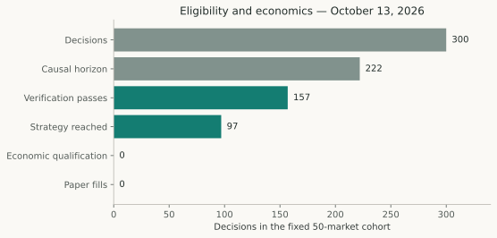

# Execution Timing and Data Freshness in Five-Minute Markets

## Abstract

A causally selected prediction can become unusable before execution. This forensic study follows 300 recorded decisions across 50 Bitcoin markets through data selection, provenance checks, inference and strategy. Of those opportunities, 143 stopped at horizon/data/provenance gates, 60 passed verification but expired at a later freshness check, and 97 reached strategy. None economically qualified. An idealized earlier handoff recovers 68 additional source-eligible observations, but the unchanged strategy rejects all of them. Latency is measurable; this cohort does not demonstrate profitable trades lost to latency.

## System and observation window

The retained pipeline acquired reference and two-sided book evidence, published snapshots, recorded first receipts, selected causal horizons, verified source and fee evidence, ran frozen inference and evaluated strategy/risk. Paper execution required a separate authorization and durable accounting path. Multiple clocks and persistence boundaries make “latency” a collection of measured intervals rather than one number.

The fixed forensic window covers October 13, 2026, targets 14:31–18:39:30 UTC: 300 decisions, 50 markets and 50 opportunities at each of six horizons. It contains 28,995 receipted observations. Later updates and the next partial market are excluded. The original report's runtime heartbeat is a dated observation, not evidence of present process liveness. [Frozen timing evidence](../sources/timing-evidence.json).

## Methods

The investigation reconstructed selected snapshots, consumed anchors, receipt times and source checks from retained CSV identities, acquisition evidence and journals. Original stores were read-only. It did not rerun finalized decisions into a ledger or assign new fills. Counts distinguish final rejection reasons from overlapping diagnostic failures.

The prediction deadline is expiry minus requested horizon. A causal observation may be at most ten seconds before that deadline. Finalization grace and execution waiting are separate mechanisms: the retained policy allows two seconds of finalization grace and up to one additional second of execution waiting. Reference and book source-age allowances are 3,000 and 500 ms, respectively, at the appropriate check. A reference allowance does not relax book freshness.

Inference is not proof of full eligibility. In this implementation it can occur before a later rejection of failed provenance, so a populated model probability cannot be counted as a strategy evaluation.

## Observed funnel

| Stage | Decisions | Share of all 300 |
|---|---:|---:|
| Recorded opportunities | 300 | 100.0% |
| Causal horizon selected | 222 | 74.0% |
| Source and fee verification passed | 157 | 52.3% |
| Later execution-source checks passed; strategy reached | 97 | 32.3% |
| Economic qualification | 0 | 0.0% |
| Risk reservations / paper fills | 0 / 0 | 0.0% |

*Figure 1. The fixed 50-market cohort. This is an eligibility view; the implementation is not a strictly sequential computation graph because inference can precede rejection of false verification flags.*

All 78 stale-horizon cases had no retained observation in the permitted target-minus-ten-seconds window. They were not cases where the selector overlooked an eligible observation. Acquisition skip logs were unavailable, so the missing observations cannot be assigned definitively to incomplete books, reference gaps or network failures.

## Timing budget

| Measured interval | n | Median | p90 | p99 |
|---|---:|---:|---:|---:|
| Target → verification | 222 | 2,471.0 ms | 3,130.2 ms | 3,535.4 ms |
| Initial processing → verification | 222 | 88.4 ms | 804.8 ms | 1,240.2 ms |
| Observation → receipt | 194 | 250.6 ms | 373.8 ms | 481.4 ms |
| YES book age at verification | 194 | 362.8 ms | 493.4 ms | 1,818.8 ms |

*Table 2. Historical descriptive quantiles. Different intervals have different available denominators. They must not be added as though their medians described the same observation.*

The median verified YES-book age leaves little room under a 500 ms limit. In the observed post-verification expiries, 55 books and five references crossed their limits before the runner's later check. Removing that later check would hide staleness rather than remove latency. Precise historical final-executor timings were not retained for every observation, so inferred zero processing time is not a valid replacement.

Some recorded book ages are negative because source and collector clocks/stages disagree. They remain signed. These differences do not prove upstream time travel, nor do they authorize clock correction without independent evidence. Receipt delay can include publication, transport, ingestion and clock effects; the retained data do not isolate each component.

## Counterfactual recovery and economics

At the earliest supported causal handoff, 165 selected observations could pass the source gates, versus 97 that reached actual strategy. The 68 additional observations include the 60 later expiries and eight earlier verification failures. The unchanged strategy rejects them for 28 probability-gap, 12 direction-disagreement, 24 price-ceiling and four nonpositive-EV reasons. Counterfactual economic qualifications remain zero.

This answers a narrower question than “would faster infrastructure help?” Faster infrastructure could improve coverage and operational reliability, but this cohort does not establish positive-EV trades foregone because of speed. It would be incorrect to report the 68 recoveries as missed fills or lost profit.

## Engineering lessons and limitations

Earlier investigations found distinct defects and bottlenecks: a selector discarded valid earlier causal snapshots; inconsistent reference-limit wiring caused avoidable strategy rejection; durable persistence and inference consumed remaining book lifetime. Those findings motivated targeted corrections and later clock/policy consolidation. Their original windows are not pooled with this 300-decision cohort.

The engineering proof is the ability to retain causal evidence, reproduce decisions and distinguish abstention causes. It does not establish exchange fill probability, account execution quality or sustained production reliability. Top-of-book depth is a sampled observation, not a queue guarantee. Missing acquisition logs, incomplete executor timestamps, clock uncertainty and the short session limit generalization.

## Reproduction and references

The [source extract](../sources/timing-evidence.json) preserves stage counts, interval summaries, counterfactual categories and the original evidence hash. `scripts/research/build_publications.py` verifies the funnel values against that evidence and generates the figure. No network or operational replay is involved.

Implementation references include `src/polybtc/shadow/runner_vnext.py`, `source_verification_vnext.py`, `orchestrator_vnext.py`, `clock_vnext.py` and `src/polybtc/data/paper_policy_vnext.py`. Historical reports include `P_PAPER_L1_REPORT.md`, `PAPER_PIPELINE_RECOVERY_REPORT.md`, `PAPER_EVALUATION_REGRESSION_REPORT.md` and `POLYBTC_DECISION_FUNNEL_REPORT.md` under `docs/`. Those filenames identify preserved evidence, not public development milestones.
