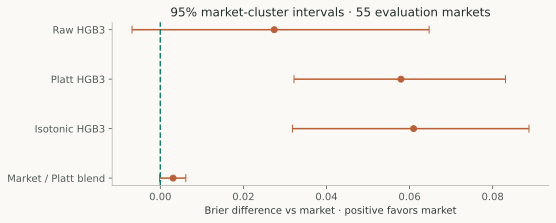

# Probability Calibration under Limited Independent Data

## Abstract

Can calibration make a frozen Bitcoin-outcome model more useful than contemporaneous market probabilities? This study fitted Platt, isotonic and market/model combination forecasts on 66 earlier observations from 42 markets, then evaluated 93 later observations from 55 markets. Market midpoint had Brier loss 0.123156, compared with 0.150580 for raw HGB3. The raw-minus-market Brier interval includes zero. Neither fitted calibrator nor the combination improved later proper scores. The result is a provisional negative finding under small-sample, selectively observed conditions, not a universal ranking of forecasting methods.

## Cohort and temporal separation

The retained research capture includes 1,032 opportunities across 172 markets. Of these, 705 stored predictions were reproducible from the unchanged HGB3 artifact; 564 additionally passed causal reference/anchor verification; 159 had fresh, bound prediction-time market books and retained official-source labels. These filters select a conditional sample.

| Partition | Observations | Markets | Prediction period, UTC |
|---|---:|---:|---|
| Calibration | 66 | 42 | October 12 14:47 – October 13 10:56 |
| Later evaluation | 93 | 55 | October 13 14:33 – 21:13 |

The boundary is October 13, 2026 at 14:30 UTC. No market crosses it. Earlier labels' recorded resolution times precede it, but full original resolution responses and first retrieval evidence are not retained. The investigation was not a prospectively preregistered strategy-selection test. Its outcomes are now exposed and cannot be reused as untouched validation. [Cohort and forecast evidence](../sources/forecast-evidence.json).

## Forecast construction

Raw HGB3 supplies uncalibrated probabilities from reference displacement, requested horizon and a causal 30-second return. Platt calibration fits logistic regression to the log odds of those probabilities, with C=1, L2 regularization and one unit of total weight per calibration market. The fitted slope is 0.382336 and intercept 0.060187. Isotonic regression is monotone and clips outside the fitting range.

The combination minimizes weighted calibration Brier with a convex mixture:

```text
p_blend = (1 − alpha) × market + alpha × Platt(raw)
alpha   = 0.136095
```

Thus the combination allocates approximately 13.61% to the calibrated model and 86.39% to market. All fitting uses the earlier partition. The model and operational strategy were not modified.

## Metrics and dependence

Each market receives equal total weight, shared across its observed horizons. Brier loss is the weighted mean of `(p − y)²`. Natural-log loss clips probabilities to [10⁻¹⁵, 1 − 10⁻¹⁵] only during scoring. Accuracy thresholds at 0.5. Expected calibration error uses ten fixed equal-width bins; it is a diagnostic, not a proper scoring rule.

For uncertainty, loss differences are paired within each market. The retained analysis uses 2,000 whole-market resamples with seed 20261014 and a sensitivity using circular blocks of six successive eligible markets. The blocks are not necessarily contiguous half-hour periods because coverage has gaps. These intervals are conditional on fitted forecasts; they do not capture all temporal dependence or model/calibration selection uncertainty.

## Results

| Forecast | Brier | Log loss | Accuracy | ECE |
|---|---:|---:|---:|---:|
| Market midpoint | 0.123156 | 0.385148 | 0.836364 | 0.095407 |
| Raw HGB3 | 0.150580 | 0.465150 | 0.772727 | 0.136479 |
| Platt HGB3 | 0.181082 | 0.548944 | 0.818182 | 0.189739 |
| Isotonic HGB3 | 0.184132 | 0.860512 | 0.656061 | 0.078945 |
| Market / Platt blend | 0.126235 | 0.401337 | 0.836364 | 0.096927 |

*Table 1. The same 93 later observations / 55 markets for every forecast. Brier and log loss were independently recalculated from the retained row-level predictions for this publication and match the saved evidence within 10⁻¹².*


*Figure 1. Market-weighted proper scores and occupied-bin reliability. Lines connect diagnostic bins; they are not fitted calibration functions. Sparse/empty bins make visual ranking unreliable. Bin counts and weights are available in the source JSON.*

The raw-minus-market Brier difference is +0.027424, with 95% market-cluster interval [−0.006809, +0.064703]. The six-market block interval is [−0.012964, +0.068115]. Both cross equality. The market has better point estimates, but these data do not establish that raw HGB3 is universally worse.



*Figure 2. Positive differences favor market. Intervals are the historical conditional whole-market bootstrap results, not a new inferential experiment. Selection uncertainty and broader regime variation are not included.*

Isotonic calibration has lower ECE than raw HGB3 but much worse log loss, including incorrect endpoint forecasts. Selecting it by ECE would ignore a proper-score failure. Platt compresses forecasts toward 0.5 and also worsens later scoring. The blend stays close to market without improving it. Raw HGB3 still beats a constant 0.5 forecast; that alone does not demonstrate incremental information.

## Coverage and interpretation

The later horizon counts are 19, 25, 18, 13, 16 and 2 for 240, 180, 120, 90, 60 and 30 seconds respectively. The favorable raw-model point estimate at 240 seconds is based on 19 observations; two 30-second observations cannot support a policy. Selecting a horizon after seeing these outcomes would create another development choice, not confirm an edge.

Only 42 calibration markets support two flexible calibration attempts and a fitted mixture. The later sample spans part of one day, and strict book/receipt requirements select for favorable data availability. More independent markets and days, a registered comparison family and calibration-selection uncertainty are needed before broad claims. This investigation supports keeping the market as the benchmark and withholding promotion of these fitted alternatives.

## Reproduction and references

```powershell
.\.venv-execution\Scripts\python.exe -B scripts/research/build_publications.py
.\.venv-execution\Scripts\python.exe -B docs/audit-20261019/check_saved_scores.py
```

The first command regenerates figures, safe source extracts and scoring checks. The second is an independent weighted-score check. Neither refits calibrators or overwrites the frozen input capture. [Source JSON](../sources/forecast-evidence.json) contains partition definitions, fitted parameters, proper scores, bin counts and intervals. The original analysis is `scripts/research/audit_s5.py`; it has fixed output paths and must be reproduced in an isolated copy if fitting and bootstrap results are to be regenerated. The publication reproduces score arithmetic, while identifying the intervals as retained historical results.
