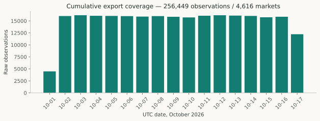

# From Market Snapshots to Causal Research Data

## Abstract

A prediction-market research dataset needs more than prices and outcomes. It must identify which market each observation describes, when its inputs originated, when the researcher could use them, and how settlement labels were obtained. This study separates historical event-time telemetry from receipt-bound observations in PolyBTC. A cumulative October export contains 256,449 observations across 4,616 markets, but overlaps training and previously inspected research. A much smaller receipt-verified cohort supports matched forecast comparison. The larger export is useful for historical quality and feature analysis; it does not create an independent evaluation period.

## The engineering question

Can the available data support a causal comparison between a Bitcoin forecasting model and contemporaneous market probabilities? Three distinct checks are required: identity, availability and outcome provenance. A finite feature value satisfies none of these by itself. A timestamp can describe an upstream event, collector observation, durable capture or first receipt. Treating those times as interchangeable can admit information that was unavailable at the decision deadline.

The research uses binary five-minute markets and requested horizons of 240, 180, 120, 90, 60 and 30 seconds before expiry. YES corresponds to the registered affirmative outcome. Market/token binding is essential: price movement alone is not an official settlement label.

## Sources and overlap

| Source | Observations / markets | Valid research role |
|---|---:|---|
| Cumulative October VM export | 256,449 / 4,616 | Historical telemetry and quality analysis |
| Archived October export | 158,284 / 2,852 | Earlier subset, not additional observations |
| Earlier October snapshot pull | 111,417 / 2,000 | Contained in the cumulative export |
| Frozen model training features | 33,366 / 5,588 | Training membership and exposed development |
| Frozen operational research capture | 1,032 / 172 | Receipt-bound eligibility investigation |
| Strict paired forecast cohort | 159 / 97 | Exposed, officially labelled forecast comparison |

The raw file runs from **October 1, 2026 at 17:15:08.609988 UTC to October 17 at 18:21:43.175985 UTC**. It is not solely an October 11–17 addition. It shares 2,851 market IDs with frozen-model training and all 172 captured operational research markets. Derived datasets must not be concatenated as independent samples. [Source and overlap inventory](../sources/data-evidence.json).



*Figure 1. Raw observations by UTC day. The first and last days are partial. The denominator is 256,449 observations, not independent predictions or labelled markets. Multiple observations describe each five-minute market.*

## Schema and validation

The 34 raw fields contain market and token identifiers, observation and expiry times, BTC/reference price, collector strike, both top-of-book quotes and sizes, reference/book source timestamps and ages, tick/minimum-order fields and timing telemetry. They do not contain official labels, first delivery receipts, an independent publication clock or a continuous depth/order-event history.

A full-file scan found zero malformed records, exact duplicates, duplicate market/observation keys, backwards observations or conflicting token/expiry bindings. This is structural validation, not authentication of the collector build or clock.

| Missing field | Rows out of 256,449 |
|---|---:|
| YES bid | 27,905 |
| YES ask | 28,386 |
| NO bid | 28,433 |
| NO ask | 27,946 |

Corresponding quote sizes are absent on the same counts. Other raw fields have no empty cells; a populated field can still have unsuitable timing or semantics. Historical `top_depth` means bid size plus ask size, not executable ask liquidity. Sequential YES and NO book reads are not an atomic market snapshot.

## Causal eligibility

For expiry E and horizon H, the prediction cutoff is T = E − H. The strict cohort selects the latest same-market observation available by T, at most ten seconds old. Source and receipt records must bind to the market, tokens and retained raw evidence. Reference age must be nonnegative and at most 3,000 ms; book ages must be nonnegative and at most 500 ms at the relevant deadline. The consumed 30-second anchor has its own timing and provenance checks.

```text
q = YES_mid / (YES_mid + NO_mid)
distance = (reference − collector_strike) / collector_strike
return_30s = current_reference / causal_anchor_reference − 1
```

The collector's opening reference is a qualified TWAP proxy, not independently authenticated official opening-strike evidence. Source-age checks do not authenticate UTC clock alignment. Negative recorded ages remain visible and fail eligibility; they are not corrected by an assumed offset.

Existing code supplies midpoint, spread, displacement and imbalance formulas. The versioned normalization preserves every original row and column, adds UTC source times and recomputed observation-time ages, and withholds normalized probability when quotes are missing or invalid. It retains rejection flags rather than silently dropping observations. All derived rows remain marked `historical_event_time_only`; no receipt time or label is synthesized. Observation-time freshness is explicitly weaker than availability at a prediction cutoff.

## Labels and evidence drift

The current retained-source audit matches 3,023 cumulative-export markets to official-source labels. An older report counted 3,104, using a label store and generated output capture that are no longer available at their referenced locations. These are different evidence snapshots, not interchangeable estimates. Neither inspected inventory supplies October 14–17 official outcomes.

Registry validation is useful but incomplete: some records lack raw resolution responses, winning-token detail or first retrieval timestamps. Missing means absent from the retained sources, not necessarily unresolved on the venue. Local BTC direction is never substituted for official settlement. The normalized derivative deliberately leaves `official_label` empty; any subsequent label join needs its own frozen source manifest.

## Implications and limitations

Raw volume substantially overstates independent, causally eligible sample size. In the retained operational cohort, 159 matched observations span only 97 markets. Additional top-size features retain that intersection, but richer historical lags reduce coverage. Missingness varies by horizon and market state, so quality-filtered forecasts cannot automatically generalize to all opportunities.

The appropriate next use of the cumulative file is reproducible historical analysis. No amount of normalization can recover unrecorded receipts, discarded reference events or missing official outcome evidence. This paper does not establish a new untouched test or authorize new collection.

## Reproduction and references

Run from the repository root with the existing execution environment and a **new** output path:

```powershell
.\.venv-execution\Scripts\python.exe -B scripts/research/normalize_publication_data.py --output data/research/publication_data_reproduction_01
```

The command verifies the registered source SHA-256, reuses `polybtc.data.dataset.features`, refuses an existing output directory, writes compressed normalized rows and records counts, rules, exclusions and hashes. It does not contact an external service. The checked-in [dataset documentation](../sources/data-evidence.json) includes the original-source hash and normalization manifest. The original CSV remains local; availability and redistribution limits are documented in `datasets/README.md`.

Figures and public source extracts are rebuilt with `scripts/research/build_publications.py`. Code references: `src/polybtc/data/dataset/features.py`, `src/polybtc/data/causal_features_vnext.py`, and `scripts/research/audit_r1_features.py`. The full historical inventory remains in `docs/POLYBTC_R1_EVIDENCE.json`.
