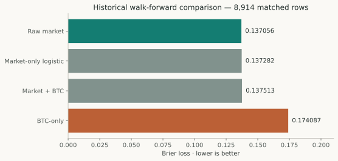

# Machine Learning versus Market-Implied Bitcoin Probabilities

## Abstract

Predicting a market outcome is different from improving on the market's own forecast. PolyBTC tested reference-price models, nonlinear families, contextual features and market-relative formulations. In a historical walk-forward comparison on 8,914 matched observations, adding BTC features to a market-only logistic control did not improve aggregate Brier or log loss. Other development experiments showed feature gains that did not transfer consistently across provider and later-period comparisons. These findings motivate strong matched market controls and explicit cohort lineage; they do not prove that all machine learning lacks incremental information.

## The benchmark that matters

A model can beat a constant 0.5 forecast while adding no information beyond a quoted market probability. The benchmark here is the contemporaneous normalized YES midpoint:

```text
YES_mid = (YES_bid + YES_ask) / 2
NO_mid  = (NO_bid + NO_ask) / 2
q       = YES_mid / (YES_mid + NO_mid)
```

This is a forecast benchmark, not an executable price. An ask, spread, fee and availability check are required for economic interpretation. A market-only fitted model also receives calibration/model-fitting privileges; comparing a tuned candidate only to an untuned weak control can misattribute fitting benefits to new information.

## Experimental lineage

Early work compared constant and reference-only baselines, logistic regression, random forests and histogram gradient boosting on chronological market groups. Market-feature tracks added quote and book information but lost rows when those features were unavailable. Later work examined residual errors, temporal robustness, market-anchored models, provider-specific context and expanded training data. These experiments reused overlapping markets and informed subsequent choices. They are historical development evidence today.

The compact HGB3 feature set is relative reference-to-strike distance, requested horizon and causal 30-second reference return. The retained expanded artifact was refitted on 33,366 examples across 5,588 markets, with prediction times from September 17 through October 11, 2026. Its saved earlier evaluation predictions belong to a predecessor trained on the earlier chronological partition. Those evaluation markets subsequently entered the full refit. They cannot independently validate the refitted artifact.

## A matched market-relative comparison

The historical market-anchored study used eight daily walk-forward folds, ordered by each market's first prediction timestamp. Fitting used earlier markets. The implemented family was `StandardScaler + LogisticRegression`, with scaling fitted on training data. Market-only used market log odds. The augmented version added relative reference displacement, requested horizon and 30-second return. BTC-only walk-forward predictions and raw market probabilities were compared on the common available rows.

| Forecast | Brier loss | Log loss | Accuracy |
|---|---:|---:|---:|
| Raw market | 0.137056 | 0.421900 | 0.801997 |
| Market-only logistic | 0.137282 | 0.422677 | 0.801660 |
| Market + BTC logistic | 0.137513 | 0.423392 | 0.801436 |
| BTC-only walk-forward | 0.174087 | 0.543055 | 0.764079 |

*Table 1. Saved historical aggregate scores on 8,914 matched rows. These retain the original report's row aggregation; they are not pooled with the later market-weighted calibration study. Lower Brier and log loss are better. [Design, fold results and scores](../sources/model-evidence.json).*

The augmented-minus-market-only Brier difference is +0.000231; augmented-minus-raw-market is +0.000457. Both favor the comparator on point estimates. These small differences do not establish equivalence. No new significance claim is attached to this historical aggregate.



*Figure 1. Historical common-row scores. The market baseline is stronger than the BTC-only model in this comparison. Differences among the market-informed forecasts are small relative to the separation from BTC-only.*

## What more complex experiments showed

The development record does contain improvements, and they should not be erased by a negative headline. A model/feature retest reported HGB3 Brier 0.126848 versus HGB4 0.120571 on 8,517 rows. However, a later block with RTDS context reported HGB3 0.130363 versus HGB4_RTDS 0.137607 on 6,678 rows. These are different experiments and cohorts; subtracting them would not measure a controlled degradation. Together they illustrate why feature/provider compatibility and later-period confirmation matter.

The expanded HGB3/XGBoost comparison also tested raw and calibrated forecasts. Its all-row evaluation denominator is 6,662, whereas only 5,054 rows have a market benchmark. At late horizons the missing-book loss is particularly large. Therefore an all-row model score must not be ranked directly against a market score from fewer, selectively observed rows. The retained comparison provides matched metrics for the appropriate comparison. Model-family differences alone cannot establish incremental value over market.

## Independent evidence and the later forecast study

The full refit was followed by a small, strictly paired chronological investigation. That study's calibration and evaluation partitions were disjoint from one another and its captured markets did not overlap the refit's training IDs. It nevertheless remains exploratory and is now exposed. Its methodology, uncertainty and calibration results belong to [Probability Calibration under Limited Independent Data](forecast-calibration.md), rather than a second presentation of the same evidence here.

The historical comparisons and the later study cannot be summed as independent trials. Provider definitions, receipt proof, weighting and eligibility differ. A future confirmatory comparison would need a frozen candidate, identical market/horizon membership, a comparably fitted market-only control, chronological calibration and a genuinely unused readout.

## Technical implications

The useful result is a disciplined benchmark hierarchy. Start with raw market, allow a fitted market-only control the same modeling privileges, compare an augmentation on matched observations, and then ask whether any improvement survives executable costs. Feature count, accuracy and successful model integration are insufficient acceptance criteria.

The tested feature families do not demonstrate a durable incremental edge. This conclusion is narrower than a universal market-efficiency claim. Historical model selection, overlapping cohorts, event-time-only data, provider shifts and missing quote coverage limit what can be inferred.

## Reproduction and references

The [source extract](../sources/model-evidence.json) records the original report hash, fold design, model comparison and selected retests. Original predictions remain under `data/normalized/` and `data/experiments/`; their availability is documented in the repository manifests.

```powershell
.\.venv-execution\Scripts\python.exe -B scripts/research/build_publications.py
```

This rebuilds figures and extracts from retained evidence; it does **not** retrain models. `scripts/research/run_p115_market_anchored_walk_forward.py` and `scripts/modeling/compare_hgb3_xgb_expanded_v2.py` are historical reproduction implementations with fixed output paths. Run those only in an isolated copy, preserving the originals. Restored top-level launchers retain their historical command/import interfaces. No retraining or deployed-model replacement was needed for this publication.
