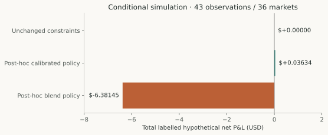

# Expected Value, Costs and the Limits of Paper Trading

## Abstract

Forecast accuracy is not a trading policy. This study examines the probability used by the implemented expected-value calculation, compares controlled probability substitutions, and separates simulated returns from observed paper executions. On 43 later observations across 36 markets that reached the original strategy stage, unchanged agreement, price and depth constraints yielded zero entries for all tested probability variants. Two post-hoc alternative policies produced a near-zero and a negative hypothetical basket. Neither establishes a credible after-cost advantage. The result supports preserving the current operational rules while treating alternative policies as unconfirmed research hypotheses.

## What the implemented strategy estimates

The strategy chooses the market-favored side from normalized midpoint probability m. Raw HGB3 must agree in direction and remain within an absolute 0.05 of m. This is a maximum-disagreement filter, not a minimum required model edge. The expected payout probability comes from the market, not HGB3.

```text
side = YES if m > 0.5, otherwise NO; exactly neutral abstains
q = m for YES, or 1 − m for NO
execution_price = selected_ask + one_tick
fee_allowance_per_share = fee_rate / 4 + 0.00001
estimated_EV_per_share = q − execution_price − fee_allowance_per_share
```

On approximately complementary books, the selected midpoint is no larger than the ask. Crossing the spread, adding a tick and allowing for fees therefore generally makes this market-based estimate negative. Normalization of inconsistent books can violate the simple inequality, so it is not a universal impossibility theorem. The formula is explicit and tested; substituting a model probability is a strategy change, not an automatic bug repair.

## Common comparison cohort

The later paired forecast study contains 93 observations from 55 markets. Only 43 observations from 36 markets reached the original execution-source, fee and strategy checks. All economic variants below use that common subset. The other 50 later forecasts and the idealized latency recoveries are excluded.

The simulation uses retained quotes that reached the strategy check, not newly measured executor timestamps or guaranteed fills. Official-source registry labels support ex-post accounting, with incomplete original response/retrieval evidence. No finalized opportunity was replayed into an operational journal. [Economic evidence and recomputed accounting](../sources/economics-evidence.json).

## Costs and risk contract

The retained policy buys five shares, requires selected ask depth of at least five, respects minimum size and uses ask plus one tick. The price ceiling is $0.70, maximum order value $7, maximum exposure $25, daily realized-loss limit $10 and at most one entry per market. These values describe the audited policy and were not retuned for this publication.

Simulated charged cash fees follow the preserved paper formula:

```text
cash_fee = round(shares × fee_rate × price × (1 − price), 5)
labelled_net_PnL = shares × (winning_label − price) − cash_fee
```

This explicit cash model preserves full shares; it is not independent evidence of actual venue fee collection or share deductions. The simulation conservatively releases no capital during the session because first settlement receipt timing is unavailable. Entry-order drawdown is not a live equity curve. A winning label alone does not establish that the order could have filled.

## Controlled probability substitutions

| Payout estimate | Positive estimated EV rows | Entries after unchanged rules | Hypothetical net P&L |
|---|---:|---:|---:|
| Market probability | 0 | 0 | $0 |
| Raw HGB3 | 13 | 0 | $0 |
| Earlier-period Platt HGB3 | 0 | 0 | $0 |
| Earlier-period market/Platt blend | 0 | 0 | $0 |

*Table 1. All 43 common observations; original side selection, agreement, gap, price and depth rules retained. Seven raw-model positive estimates fail the disagreement limit and six fail the price ceiling. Trade-level forecast metrics and win rates are undefined when no entries occur.*

The absence of entries is a valid measured outcome. It should not be “fixed” by widening thresholds until a favorable basket appears. Nor does it prove that all future opportunities or calibrated model policies must fail.

## Explicit post-hoc alternatives

Two alternatives choose whichever side has the larger positive cost-adjusted edge and omit the old agreement/gap filters. They retain the same price, size, fee and capital assumptions. This deliberately changes the research policy; the results are exploratory.

| Alternative | Hypothetical entries | Labelled net P&L | Entry-order drawdown | Win rate |
|---|---:|---:|---:|---:|
| Platt-based side selection | 23 | +$0.03634 | $7.35829 | 21.74% |
| Blend-based side selection | 13 | −$6.38145 | $7.53359 | 7.69% |



*Figure 1. Total labelled hypothetical net P&L under retained paper assumptions. The positive bar is effectively zero on the scale of the basket. These are conditional simulations, not cash earned or observed paper executions.*

Platt's compression toward 0.5 can make underdogs appear attractive, even when the calibration model does not improve later forecast scores. Positive estimated EV is not verified true EV. A basket of 23 entries with +$0.03634 does not support a profitability claim, particularly after policy selection and uncertain fill/settlement mechanics. Favorable sensitivities involving only one or a few entries cannot reverse that evidential limitation.

## What the engine demonstrates

The software retains separate prediction, strategy, risk, execution, accounting and settlement responsibilities. Tests cover verification gates, reservations, order lifecycle, durable hypothetical fills, reconciliation and restart behavior. A research policy can be evaluated offline without changing the operating configuration. The live adapter remains disabled and public research pages expose no trading controls.

This is substantial engineering functionality. Its value is auditable behavior and reproducible abstention as well as simulated execution; it is not evidence of trading profitability. Historical account activity, earlier backtests and this forecast cohort have different contracts and must remain separate.

## Limitations and implications

The sample is small, selected for source eligibility and concentrated in one session. Policy alternatives were examined after the cohort existed. Calibration fitting uses few markets, and uncertainty in forecasts is not converted into a validated per-trade edge bound. Actual fill competition, final executor delays, venue fee mechanics and settlement availability are incompletely observed.

A credible future policy needs a frozen probability estimator and side-selection rule, a matched market-only policy, realistic timing/costs, dependence-aware uncertainty and a genuinely later evaluation. This publication establishes none of those by retuning existing data. It reports no credible after-cost advantage for the tested alternatives.

## Reproduction and references

```powershell
.\.venv-execution\Scripts\python.exe -B scripts/research/build_publications.py
```

The builder independently recalculates each retained alternative trade's payout-minus-cost arithmetic and checks basket sums, then emits figures and a safe evidence extract. It does not rerun policy selection, inference or execution. Full original sensitivity tables remain in `docs/POLYBTC_S5_EVIDENCE.json`; the [public extract](../sources/economics-evidence.json) retains their assumptions and aggregate results.

Code references: `src/polybtc/strategy/vnext.py`, `src/polybtc/risk/vnext.py`, `src/polybtc/shadow/executor_vnext.py` and `scripts/research/audit_s5.py`. The last script writes historical fixed paths; reproducing its full simulation requires an isolated copy. The deployed artifact, strategy thresholds and operational journals remain unchanged.
